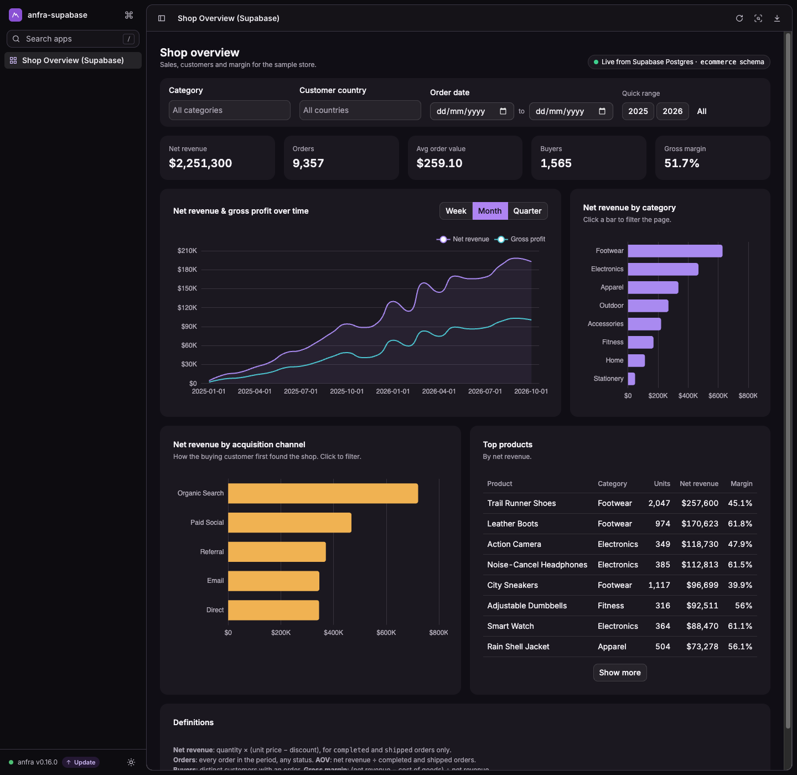

# anfra × Supabase demo

Put a semantic layer and live dashboards on top of your **Supabase** Postgres database with
**[anfra](https://anfra.ai)**, in about 10 minutes, without copying any data out.

```
 Supabase Postgres  ──(read-only role, Session pooler)──▶  anfra  ──▶  AQL queries · Data Apps · AI agents
 ecommerce schema                                           models/ datasets/ apps/
```

What's in this repo:

| Path | What it is |
|---|---|
| [`supabase/seed.sql`](supabase/seed.sql) | Creates an `ecommerce` schema (customers, products, orders, order_items) with ~14k orders of deterministic sample data. |
| [`supabase/anfra_reader.sql`](supabase/anfra_reader.sql) | A **read-only** Postgres role for anfra. |
| [`scripts/setup.sh`](scripts/setup.sh) | One command: seeds Supabase, creates the role, writes `.anfra/data_sources.yml`. |
| [`models/`](models) | AML models, one per table. |
| [`datasets/shop.dataset.aml`](datasets/shop.dataset.aml) | The `shop` dataset: relationships plus business metrics (Net Revenue, AOV, Gross Margin, Return Rate…). |
| [`apps/shop_overview.html`](apps/shop_overview.html) | A Data App: KPIs, trend, breakdowns, top products, with filters and cross-filtering. |
| [`TUTORIAL.md`](TUTORIAL.md) | Blog post: connect anfra to **your own** Supabase database, with your coding agent doing the modelling. |



## Quick start

You need a Supabase project, `psql`, and the anfra CLI.

```sh
# 1. Install anfra
curl -fsSL https://raw.githubusercontent.com/holistics/anfra/main/install.sh | bash

# 2. Clone this repo
git clone https://github.com/holistics/anfra-supabase-demo.git
cd anfra-supabase-demo

# 3. Point it at your Supabase project (Dashboard → Connect → Session pooler)
export SUPABASE_DB_URL='postgresql://postgres.<project-ref>:<password>@aws-0-<region>.pooler.supabase.com:5432/postgres'

# 4. Seed data, create a read-only role, configure anfra
./scripts/setup.sh

# 5. Check the models and open the dashboard
anfra validate
anfra serve        # → http://127.0.0.1:7878/apps/shop_overview
```

Ask a question in AQL:

```sh
anfra query --dataset shop '
explore {
  dimensions { category: products.category }
  measures   { net_revenue: net_revenue, gross_margin: gross_margin }
  sorts      { net_revenue desc }
}'
```

Then ask your coding agent (after `anfra agent setup`): *"Using the `shop` dataset, which acquisition
channel brings the highest AOV in 2026?"*

**Want this on your own Supabase tables?** Follow [TUTORIAL.md](TUTORIAL.md): a read-only role,
RLS policies, and prompts to have your agent model your tables and define your metrics.

## Why a read-only role and the pooler?

- **Read-only**: anfra only reads. `anfra_reader` has `SELECT` on one schema,
  `default_transaction_read_only = on` and a 60s statement timeout, so nothing it runs can change
  your data.
- **Production performance (optional)**: analytics queries still run on your primary database. If
  you want to keep them off it, point anfra at a
  [Supabase read replica](https://supabase.com/docs/guides/platform/read-replicas) instead: same
  config, the replica's host.
- **Session pooler**: Supabase's direct host (`db.<ref>.supabase.co`) is IPv6-only. The Session
  pooler works over IPv4 everywhere. On the pooler the user is written `<role>.<project-ref>`.
- **Not exposed over the API**: the `ecommerce` schema is not in Supabase's *Exposed schemas*, so
  the demo tables aren't reachable through the auto-generated REST/GraphQL API.

## Learn more

- anfra docs: https://anfra.ai/docs
- AML & AQL language docs: https://amql.org/docs
- Community: https://community.anfra.ai

## License

MIT
