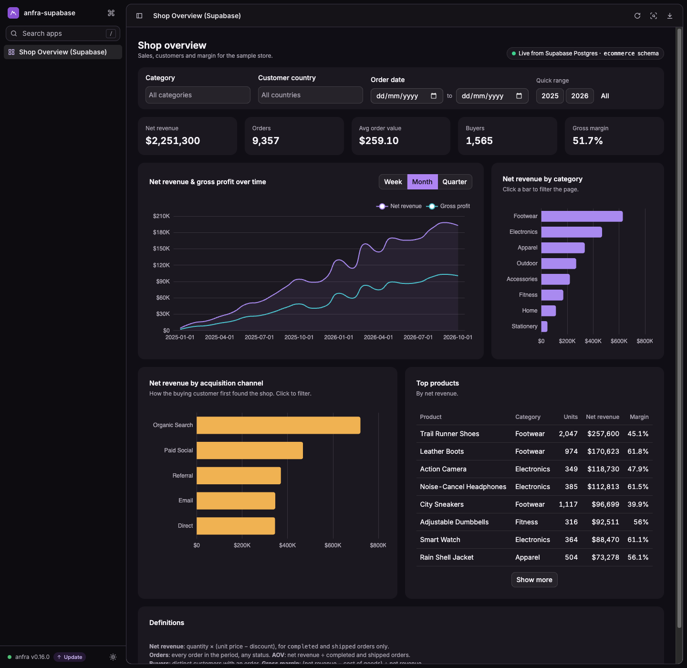

# Build trusted internal analytics on Supabase, for free, with your coding agent

> **TL;DR**: Give anfra a read-only login to your Supabase Postgres, then ask your coding agent
> (Claude Code, Codex, Cursor…) to model your tables, define your metrics, answer questions,
> build a dashboard and publish it to your team (it's for your team, not your app's users). You stay in charge of what an agent shouldn't
> decide alone: **access** and **what your numbers mean**. After installing anfra, a
> [single prompt](#the-prompt-steps-2-to-7-in-one-go) does Steps 2 to 7 and stops each time
> it needs you. No ETL, no copy of your data, and anfra is open source (Apache 2.0).
>
> Want to try it on sample data first? The **[demo repo](https://github.com/holistics/anfra-supabase-demo)**
> seeds a small store into Supabase and has everything below already built.



## Why do this?

Supabase is a great place to *run* your app. Sooner or later someone asks *"what was our net
revenue last quarter, by category?"*. You can ask an AI agent to write the SQL, but each time it
re-guesses which tables to join and what "net revenue" means, and two people asking the same
question get two different numbers.

[anfra](https://anfra.ai) adds a **semantic layer** on top of the same Postgres:

- **Metrics are defined once**, in plain-text files in Git: "net revenue" means one thing, and
  changes to it go through code review.
- **Agents query the definitions, not raw tables.** With anfra's skills, your agent writes AQL
  that names fields and metrics. anfra writes the joins and the SQL.
- **Dashboards are code too.** A Data App is one HTML file in your repo, served by `anfra serve`.

Data stays in Supabase. anfra reads it live, through a login that can't write.

## Who does what

**Your agent does most of the work:**

- writes the SQL for a read-only database role
- explores your schema and writes the models and relationships
- turns your metric definitions into code and validates the repo
- answers questions, then checks its answers against plain SQL
- builds and refines dashboards

**You make the decisions:**

- which tables and columns anfra may read, and approving the role before it's created
- the database password, which you type into a local file yourself, never into the chat
- what each metric means for *your* business
- reviewing the models, checking a few numbers, and publishing to your team

The split is deliberate. An agent can draft everything, but it shouldn't decide on its own what
it's allowed to read or what counts as revenue. That's how the post works: after installing,
you paste [**one prompt**](#the-prompt-steps-2-to-7-in-one-go) that covers Steps 2 to 7, and
the agent pauses at each of these decisions.

**You need:** a Supabase project with your app's data, a coding agent, and macOS or Linux.
**Time:** about 20 minutes.

---

## Step 1: Install anfra and give your agent the skills

Open your agent in an empty folder (say `my-analytics`) and ask:

> **You:** Install the anfra CLI (https://anfra.ai/docs), then in this folder run `git init`,
> `anfra init` and `anfra agent setup`.

Or run it yourself:

```sh
curl -fsSL https://raw.githubusercontent.com/holistics/anfra/main/install.sh | bash

mkdir my-analytics && cd my-analytics && git init
anfra init           # .anfra/ config, models/, datasets/, apps/, AGENTS.md
anfra agent setup    # installs the anfra skills into the coding agents it finds
```

`anfra agent setup` teaches your agent anfra's languages (AML for models, AQL for queries) and
commands. **Then restart the agent**, still in `my-analytics`. An agent loads its skills when it
starts, so without a restart it would do the rest from memory, and guess.

> Keep this repo separate from your app's code, or put it in an `analytics/` folder inside it.
> Either works. It's just files.

## The prompt: Steps 2 to 7 in one go

After the restart, one prompt takes the agent through Steps 2 to 7. It stops wherever you have
to decide something. Fill in the brackets and paste it:

> **You:** Set up anfra on my Supabase database so we can analyse our [sales] data. Go step by
> step, and stop where I've written **STOP**.
>
> - **Step 2.** Write the SQL for a read-only role `anfra_reader`. It should read the app
>   tables in `public` (nothing in `auth` or `storage`), be read-only with a 60s statement
>   timeout, and have a select policy on every table with Row Level Security turned on. Leave
>   out personal data like email, phone and address columns. List any views and any
>   `security definer` functions it could reach. Use `<password>` as the password. **STOP**
>   so I can review and run it.
> - **Step 3.** Connect anfra as the data source `supabase`, logging in as `anfra_reader`
>   through this Session pooler string: `[paste it from Supabase → Connect]`. Leave
>   `<password>` as a placeholder. **STOP** so I can fill in the password. Then list the tables
>   with row counts, and point out any table that shows 0 rows.
> - **Step 4.** Model the tables that matter for [sales], and put them in a dataset called
>   `[shop]` with their relationships. Run `anfra validate`. Show me the primary keys and
>   relationships. **STOP** for my review.
> - **Step 5.** Propose definitions for these metrics: [net revenue, AOV, gross margin, return
>   rate]. Point out anything ambiguous, like which order statuses count. **STOP** for me to
>   confirm them, then add them to the dataset.
> - **Step 6.** Answer "[net revenue and gross margin by product category]" with AQL, and
>   check the total against a plain SQL query.
> - **Step 7.** Build a Data App called "[Sales overview]" with KPIs, a trend over time, the
>   main breakdowns and a date filter. Tell me how to open it. Then commit the repo, run
>   `anfra publish check` and show me what would be published. Don't publish; I'll do that.

Paste the Session pooler string from Supabase's **Connect** button. It shows `[YOUR-PASSWORD]`
instead of your password, so it's safe to share. You can also be more specific than the
brackets suggest: name the tables to model, or describe the dashboard you want. The rest of
this post uses the names above, the `shop` dataset and a "Sales overview" app. Read your own
names in their place.

The steps below follow the prompt. Each one says what the agent does, **what you check** when
it stops, and what you might say back.

## Step 2: Approve a read-only role

**The agent** writes the SQL for a role that can read your app's tables and nothing else. If
it's opened in your app's repo, it works from `supabase/migrations`, and you run the SQL in the
Supabase **SQL Editor**. If it's connected through the
[Supabase MCP server](https://supabase.com/docs/guides/getting-started/mcp), it can run the
SQL itself, after you approve each statement.

The core of it looks like this (the demo has a complete version in
[`supabase/anfra_reader.sql`](https://github.com/holistics/anfra-supabase-demo/blob/main/supabase/anfra_reader.sql)):

```sql
create role anfra_reader login password '<password>';

-- Read access to your app's tables. Not auth, storage or other Supabase internals.
grant usage  on schema public to anfra_reader;
grant select on all tables in schema public to anfra_reader;
-- Optional: also make tables created later readable. It only covers tables
-- created by the role that runs it (usually `postgres`). Leave this out if
-- you'd rather grant each new table yourself.
alter default privileges in schema public grant select on tables to anfra_reader;

-- Guard rails
alter role anfra_reader set default_transaction_read_only = on;
alter role anfra_reader set statement_timeout = '60s';
```

The role has no `insert`, `update` or `delete` grants, so it can't change your tables. The
read-only default is a second layer that makes any write fail straight away (`cannot execute
INSERT in a read-only transaction`).

**You check:**

- **A read policy on every table with RLS.** `anfra_reader` usually matches none of your
  app's policies (they're written `to authenticated` or `to anon`), so without its own it **sees zero rows, without any error**. Each table needs
  something like:
  ```sql
  create policy anfra_reader_read on public.orders for select to anfra_reader using (true);
  ```
- **Column grants for personal data.** Tables with emails, phone numbers or addresses should
  grant only the columns analysts need:
  ```sql
  revoke select on public.customers from anfra_reader;
  grant select (id, country, city, acquisition_channel, created_at) on public.customers to anfra_reader;
  ```
- **Views.** The grant covers views too, and a Supabase view runs as its owner unless it's
  created `with (security_invoker = on)`. Such a view skips RLS and column grants, so revoke
  `select` on any that expose personal data.
- **`security definer` functions.** Every role can run functions by default. If one in
  `public` writes data, decide whether to revoke `execute` on it.
- **Load.** A read-only login protects your data, not your database's CPU. To keep analytics
  off your primary, use a [read replica](https://supabase.com/docs/guides/platform/read-replicas)
  host in Step 3.

**You:** replace `<password>` with a strong one and run the SQL. If the agent ran it through
MCP, set the password yourself in the SQL Editor (`alter role anfra_reader password '…'`), so
it never passes through the chat. Then: *"Role's created, go on."*

## Step 3: Add the password

`anfra init` created two files with a `warehouse` placeholder: `.anfra/data_sources.yml`
(git-ignored, for your credentials) and `.anfra/data_sources.yml.example` (committed, for your
teammates). **The agent** replaces the placeholder in both with your connection, leaving the
password out of the example:

```yaml
data_sources:
  supabase:
    type: postgresql
    connection:
      host: aws-0-<region>.pooler.supabase.com
      port: 5432                       # a number, not "5432"
      user: anfra_reader.<project-ref>
      password: <password>             # you replace this
      dbname: postgres                 # `dbname`, not `database`
    settings:
      require_ssl: true
```

**You check:**

- **The host is the Session pooler,** copied exactly from Connect (it starts with `aws-0-` or
  `aws-1-`), not `db.<ref>.supabase.co`. That direct host is IPv6-only, and many laptops and
  CI runners can't reach it.
- **The user carries the project ref:** `anfra_reader.<project-ref>`, not `anfra_reader`.

**You:** open `.anfra/data_sources.yml` in your editor and replace `<password>`. That's the only
thing you type yourself, and it never goes through the chat. Then: *"Password's in, go on."*

The agent connects and lists your tables with their row counts. If a table you care about
shows **0 rows** but has data in the Supabase table editor, it's missing an RLS policy: back to
Step 2. If the first login fails right after you set the password, wait a minute: the pooler
caches passwords briefly.

## Step 4: Review the models

**The agent** looks at your columns and sample values, then writes one `models/<table>.model.aml`
per table and a `datasets/shop.dataset.aml`. A **model** describes one table: its fields, types
and primary key. The **dataset** groups the models, says how they join, and will hold your
metrics. A model looks like this:

```aml
Model orders {
  type: 'table'
  label: 'Orders'
  data_source_name: 'supabase'
  table_name: '"public"."orders"'

  dimension id {
    type: 'number'
    primary_key: true
    definition: @sql {{ #SOURCE.id }};;
  }
  dimension status {
    type: 'text'
    description: 'completed / shipped / returned / cancelled'
    definition: @sql {{ #SOURCE.status }};;
  }
  // created_at, customer_id, channel …
}
```

**You check** it like a pull request. `anfra validate` passing only means the files are well
formed.

- **Primary keys.** Every model has one, and it really is unique.
- **Relationships point the right way.** `relationship(order_items.order_id > orders.id, true)`
  means many order items to one order. A reversed relationship makes totals double count.
- **Types.** Money columns are `number`, timestamps are `datetime`, and ids that are really
  codes are `text`.
- **Nothing sensitive slipped in.** If it did, have it removed and tighten the grant from Step 2.

**You:** say what's off in plain words, or approve it:

> `order_items.product_id` joins to `products.id`, not `products.sku`. And drop the
> `audit_log` table, we don't need it.

## Step 5: Define your metrics

**The agent** can see that `orders` has a `status` column, but it can't know whether your
finance team counts refunded orders as revenue. So it proposes definitions, points out what's
ambiguous, and stops. This is the step it can't do for you.

**You check** each proposal against how your business actually counts, and pay most attention
to what it flagged as ambiguous. Start with the metrics your team already argues about: that's
where a semantic layer pays off first.

**You:** answer with your definitions:

> Use these:
> - **Net revenue**: quantity × (unit price − discount), only for `completed` and `shipped` orders.
> - **AOV**: net revenue per completed or shipped order.
> - **Gross profit**: net revenue minus quantity × product unit cost, same statuses.
> - **Gross margin**: gross profit / net revenue.
> - **Return rate**: share of all orders, cancelled ones included, with status `returned`.
> - **Buyers**: distinct customers with at least one order.

The agent adds them to the dataset, each built on the ones before it:

```aml
  metric net_revenue {
    label: 'Net Revenue'
    type: 'number'
    description: 'Line amounts after discounts, completed and shipped orders only.'
    definition: @aql sum(order_items.net_amount) | where(orders.status in ['completed', 'shipped']) ;;
    format: '[$$]#,###0'
  }

  // cogs, gross_profit …

  metric gross_margin {
    label: 'Gross Margin %'
    type: 'number'
    definition: @aql safe_divide(gross_profit, net_revenue) ;;
    format: '#,##0.0%'
  }
```

The "completed and shipped only" rule now lives in one place. Each `description` is what the
next agent or person reads before using the metric, so make sure they're clear.

## Step 6: Check a number

**The agent** answers the question from your prompt with AQL against the `shop` dataset:

```
explore {
  dimensions { category: products.category }
  measures   { net_revenue: net_revenue, gross_margin: gross_margin }
  sorts      { net_revenue desc }
}
```

| category | net_revenue | gross_margin |
|---|---:|---:|
| Footwear | $628,951 | 49.7% |
| Electronics | $468,331 | 54.8% |
| Apparel | $335,390 | 51.8% |
| Outdoor | $269,376 | 52.6% |
| … | | |

*(Results are from the demo store's data, formatted for reading. The CLI prints raw numbers
such as `628950.6` and `0.4968`. Yours will be your own.)*

The query never mentions `order_items`, `unit_cost` or a join: anfra works those out from the
dataset. Then the agent runs a plain SQL query against Supabase for the same total.

**You check** that the two totals match. If they don't, the difference usually points at a
wrong relationship or metric. Fix the definition once, and every later answer is fixed too.

**You:** keep asking. Questions across several tables work the same way, and for the first few,
ask for the same check:

> Which acquisition channel brings the most buyers, and what's their AOV and return rate?
> Check the buyer count against plain SQL.

## Step 7: Open the dashboard

**The agent** writes `apps/sales_overview.html`, one HTML file whose queries are AQL against
your metrics, so the dashboard and the chat can't disagree. Then it commits the repo.

**You check** the page in your browser:

```sh
anfra serve
# Data Apps  http://127.0.0.1:7878/apps/
```

and that the commit left out your credentials: `git log --stat -1` should list
`.anfra/data_sources.yml.example`, but not `.anfra/data_sources.yml`.

The agent also shows you what `anfra publish check` would send to your org. You'll use that
in Step 8.

**You:** shape the page in conversation, as specifically as you like:

> Add a week / month / quarter switch to the trend, revenue by acquisition channel, and the
> top 10 products. Add a country filter, and make clicking a category bar filter the rest of
> the page. Commit when it's done.

Your models, metrics and dashboards are now plain files in Git. When someone changes what "net
revenue" means, it shows up as a diff in a pull request. Teammates who code can clone the repo,
add their own credentials, run `anfra agent setup`, and their agents use the same definitions.

## Step 8: Publish to your team

Everyone else shouldn't need a terminal to see the dashboard. `anfra publish` uploads the repo to
an org on [anfra Cloud](https://anfra.ai/cloud/), which is free during its beta. Your team then
signs in and opens the Data Apps in the browser, and their agents can connect to the same metrics
through anfra Cloud's MCP server.

First see what would go up (the agent already ran this at the end of Step 7):

```sh
anfra publish check
```

It lists only your `.aml` files and everything under `apps/`. `.anfra/` stays local, `.env`
files and notes don't go, and `.gitignore` doesn't affect it. Then publish:

```sh
anfra publish
```

The first time, it offers your stored logins or signs you in, and asks which org to publish
to. It saves the org's address (`https://<server>/o/<org>`) as `org.url` in
`.anfra/config.yml`. Commit that file so everyone on the team publishes to the same org. To
set the org without being asked, for example in CI, use `anfra publish --set-org <org url>`.

Things to know:

- **The `supabase` data source is created in the org on the first publish**, from your
  `.anfra/data_sources.yml`, after you confirm. Its credentials are stored encrypted on anfra
  Cloud. This is the `anfra_reader` login from Step 2, so the hosted copy can't write either.
- **Queries still run on Supabase.** Results pass through anfra Cloud on the way to the page; no
  copy of your tables is kept.
- **A publish replaces what's there.** Files you deleted locally are deleted in the org too.
  Validation runs locally and again on the server, and nothing is published if either fails.
- **Each publish is kept as a version**, with who published it and when. The message defaults to
  your latest commit, or set one with `-m "…"`.

Then invite your team in anfra Cloud and give each person a role.

> Publish from `main` after the pull request is reviewed, and you get a simple release process:
> the metric definitions your team sees are always the reviewed ones.

---

## Prompting tips

- **Name the dataset**: *"using the `shop` dataset…"*. That keeps the agent on your definitions
  instead of raw SQL.
- **Give definitions, not just names.** "Active customer" means something different in every
  company.
- **Ask it to verify.** *"Check that against SQL"* costs one query and catches modelling mistakes
  early.
- **Ask to see the AQL** when a number surprises you. It's short enough to read.
- **Fix the model, not the answer.** If an answer is wrong because a definition is wrong, ask the
  agent to fix the metric, not to patch that one query.

## Doing it by hand

Everything the agent does goes through the `anfra` CLI, which you can also use yourself:

```sh
anfra query --lang sql -s supabase 'select count(*) from public.orders'   # raw SQL, read-only
anfra validate                                                            # check every model and dataset
anfra show shop                                                           # fields and metrics as AQL sees them
anfra query --dataset shop 'explore { measures { net_revenue: net_revenue } }'
anfra serve                                                               # Data Apps and MCP at :7878
anfra publish check                                                       # what would go to your org
```

AML and AQL are documented at [amql.org/docs](https://amql.org/docs). For a complete, working set
of models, metrics and a Data App, see the
[demo repo](https://github.com/holistics/anfra-supabase-demo).

## Troubleshooting

| Symptom | Fix |
|---|---|
| A table shows **0 rows** through anfra, but has data in Supabase | RLS: add a `for select to anfra_reader` policy on that table (Step 2). |
| `could not translate host name db.<ref>.supabase.co` | That host is IPv6-only. Use the Session pooler host. |
| `Tenant or user not found` | The pooler host doesn't match Connect (region, or `aws-0` vs `aws-1`). |
| `no tenant identifier provided` | The user is missing `.<project-ref>`: use `anfra_reader.<project-ref>`. |
| `password authentication failed` right after changing the password | The pooler caches credentials for a short while. Wait a minute and retry. |
| `invalid config for dbtype` | `port` must be a number (`5432`), not `"5432"`, and the database key is `dbname`, not `database`. |
| `permission denied for table …` / `for schema …` | Add `grant usage on schema …` / `grant select on …` for `anfra_reader`. Tables in a newly created schema need the grants again. |
| `cannot execute … in a read-only transaction` | Working as intended: the role is read-only. |
| Everything stopped working after a quiet week | Free-tier Supabase projects pause after a week without activity. Restore the project from the Supabase dashboard. |
| Works locally, but published apps can't reach the database | If you turned on Supabase **Network Restrictions**, anfra Cloud's addresses must be allowed too. |
| The agent writes raw SQL instead of AQL | Check `anfra agent setup check`, restart the agent, and name the dataset in your prompt. |

## Links

- Demo repo with sample data: https://github.com/holistics/anfra-supabase-demo
- anfra docs: https://anfra.ai/docs
- anfra Cloud: https://anfra.ai/cloud/
- AML & AQL docs: https://amql.org/docs
- Supabase connection docs: https://supabase.com/docs/guides/database/connecting-to-postgres
- Supabase Row Level Security: https://supabase.com/docs/guides/database/postgres/row-level-security
